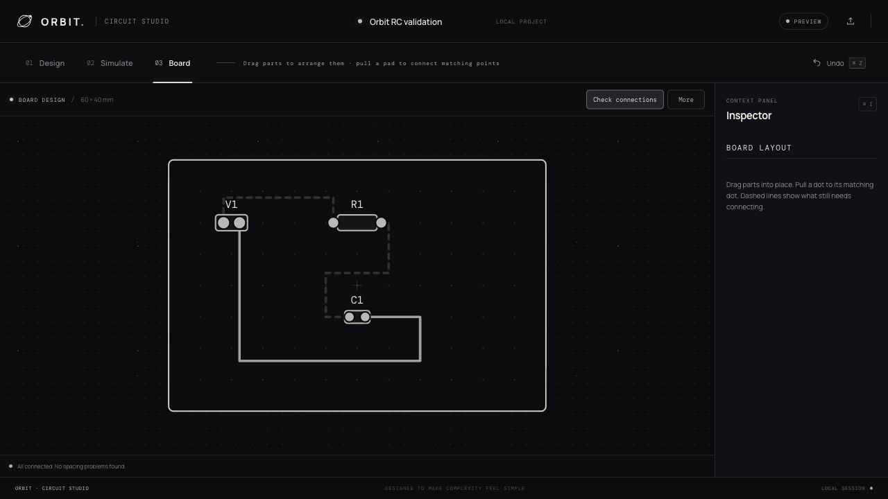

# ORBIT — Circuit Studio

A browser-based circuit and PCB editor focused on simple interactions: place parts, pull wires, simulate, and lay out a board. 

**Status:** working prototype under active development.



## Try it locally

No dependency installation or build step is needed. With Python 3 installed:

```sh
python3 -m http.server 5173 --bind 127.0.0.1 --directory dist
```

Open **http://127.0.0.1:5173**. The app starts with an RC circuit.

1. **Design:** add resistors, capacitors, a voltage source, and ground. Drag parts to move them; pull between pins to connect. Each schematic part has a rotate indicator.
2. **Simulate:** run the circuit to view DC results and its step response.
3. **Board:** arrange physical parts and pull between matching pads to route copper. Dashed guides show connections that still need routing. Use **Check connections** to find routing and spacing issues.
4. **More:** change copper layer, trace width, and board dimensions, or export a native KiCad PCB file.

Edits autosave in your browser. Save/import JSON projects to move them between browsers. Command/Ctrl-Z undoes changes; Escape cancels wiring. On the schematic, scroll to zoom and hold Space while dragging to pan.

## Implemented features

- Schematic editing with explicit pin connectivity, editable values, rotation, undo, and JSON import/export.
- DC operating-point simulation using modified nodal analysis.
- Linear RC transient simulation using backward Euler integration.
- PCB placement stored separately from the schematic, in millimeters.
- Top and bottom copper routing with through-hole pads and drills.
- Same-net routing checks, disconnected-net checks, basic copper clearance and board-edge checks.
- Native `.kicad_pcb` export with embedded custom footprints.

The voltage source becomes a two-pin power connector on the PCB. Ground is a reference connection and has no physical footprint. Moving or rotating a board part clears its attached traces so they can be redrawn.

## Example project

Import [the schematic example](evidence/rc-project.json) or [the routed board project](evidence/rc-routed.json).

The example has a **5 V source, 1 kΩ resistor, and 1 µF capacitor**, giving a time constant of **1 ms**. Its capacitor voltage approaches 5 V and reaches about 3.16 V after one time constant; the numerical integration approximates that response.

An [exported board](evidence/rc-board.kicad_pcb) and a [rotated export](evidence/rc-rotated.kicad_pcb) are included. Both sample boards were checked with KiCad 9.0.7 and reported zero violations and zero unconnected items. The corresponding reports are in `evidence/`. Those results apply to these fixtures, not every board created with the editor.

## Validation

With Node.js installed:

```sh
node solver.test.mjs
node pcb.test.mjs
```

Simulation tests compare an equal-resistor divider and RC circuit against analytical values, and check missing ground, unconnected pins, and floating-node errors. PCB tests cover physical pads, refusal to connect different nets, routed connectivity, independent placement, schematic synchronization, edge violations, and crossing traces. PCB tests regenerate the sample board files.

To independently check the exported sample with KiCad's CLI:

```sh
kicad-cli pcb drc --exit-code-violations evidence/rc-board.kicad_pcb
```

## Current limitations

- Simulation supports resistors, capacitors, and ideal voltage sources; semiconductor models, AC sweeps, and a general SPICE engine are not implemented.
- Transient analysis uses a fixed 20 ms window with 50 µs steps, zero initial capacitor voltage, and voltage sources stepping on at time zero.
- The output probe is fixed to the first capacitor's first pin relative to ground, falling back to a resistor or source.
- PCB footprints are fixed: a 7.62 mm resistor, 2.5 mm capacitor, and 2.54 mm power connector. Match actual component dimensions before fabrication.
- There are no vias, copper pours, arbitrary footprint libraries, or direct Gerber export. Continue in KiCad for final checking and manufacturing output.
- Board checks cover a limited set of constraints. Verify footprints against datasheets and run KiCad DRC before ordering hardware.
- Projects are browser-local, with up to 60 components and 200 schematic wires. There is no collaboration backend.

## Code map

| File | Purpose |
| --- | --- |
| `dist/app.js` | Editor state, schematic interactions, and UI |
| `dist/solver.mjs` | DC and transient circuit solver |
| `dist/pcb.mjs` | Physical board model, routing, checks, and KiCad export |
| `dist/index.html`, `dist/styles.css` | Accessible controls and monochrome interface |
| `solver.test.mjs`, `pcb.test.mjs` | Numerical and PCB regression checks |

The app uses plain HTML, CSS, JavaScript modules, and SVG. Google Fonts supplies the interface fonts.
